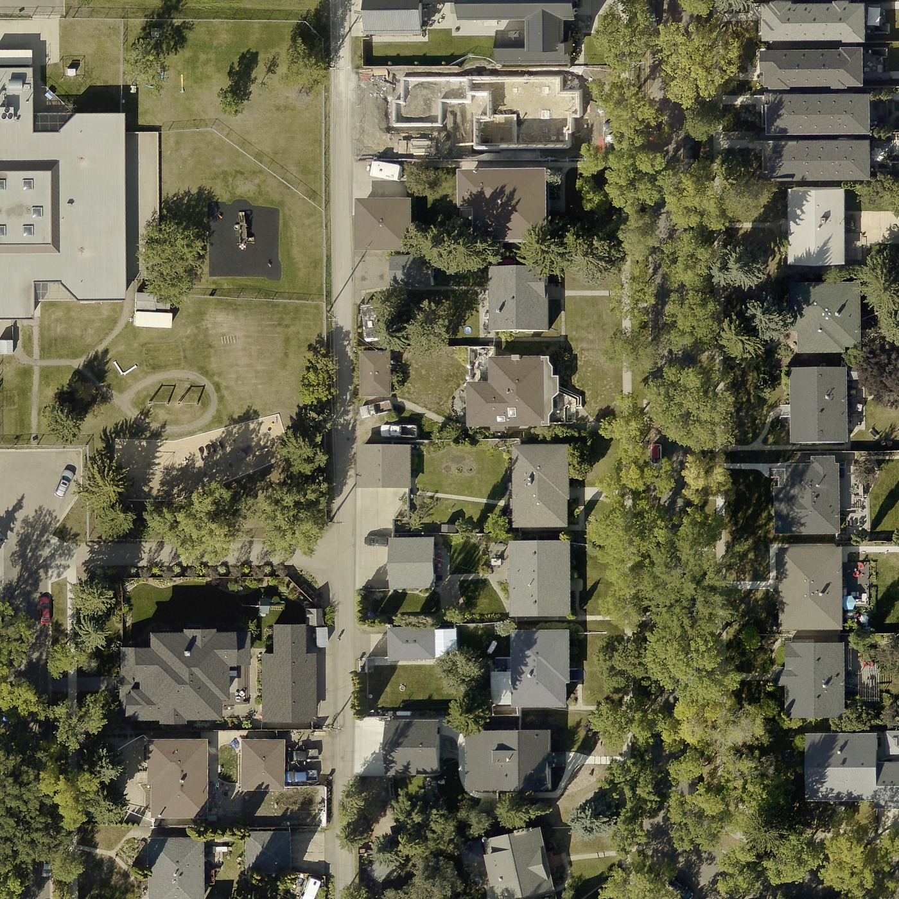
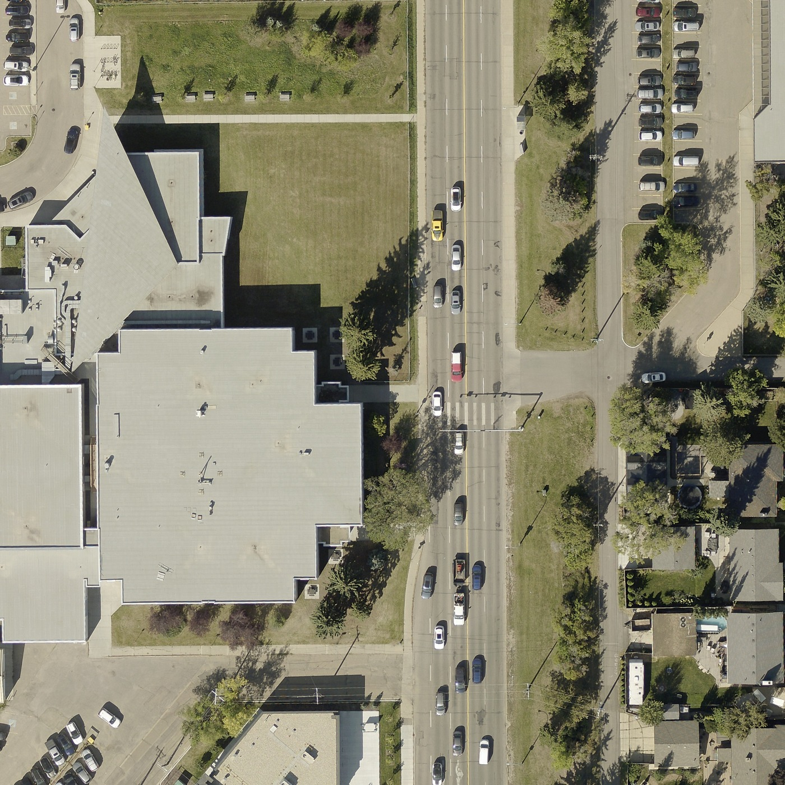
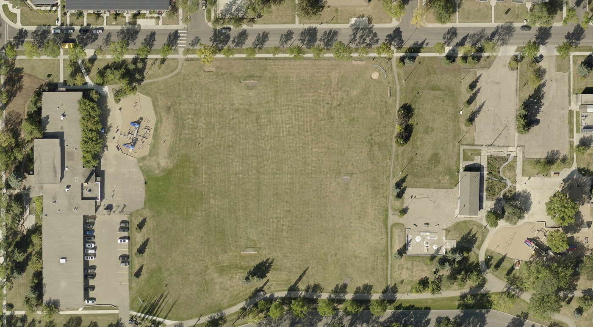
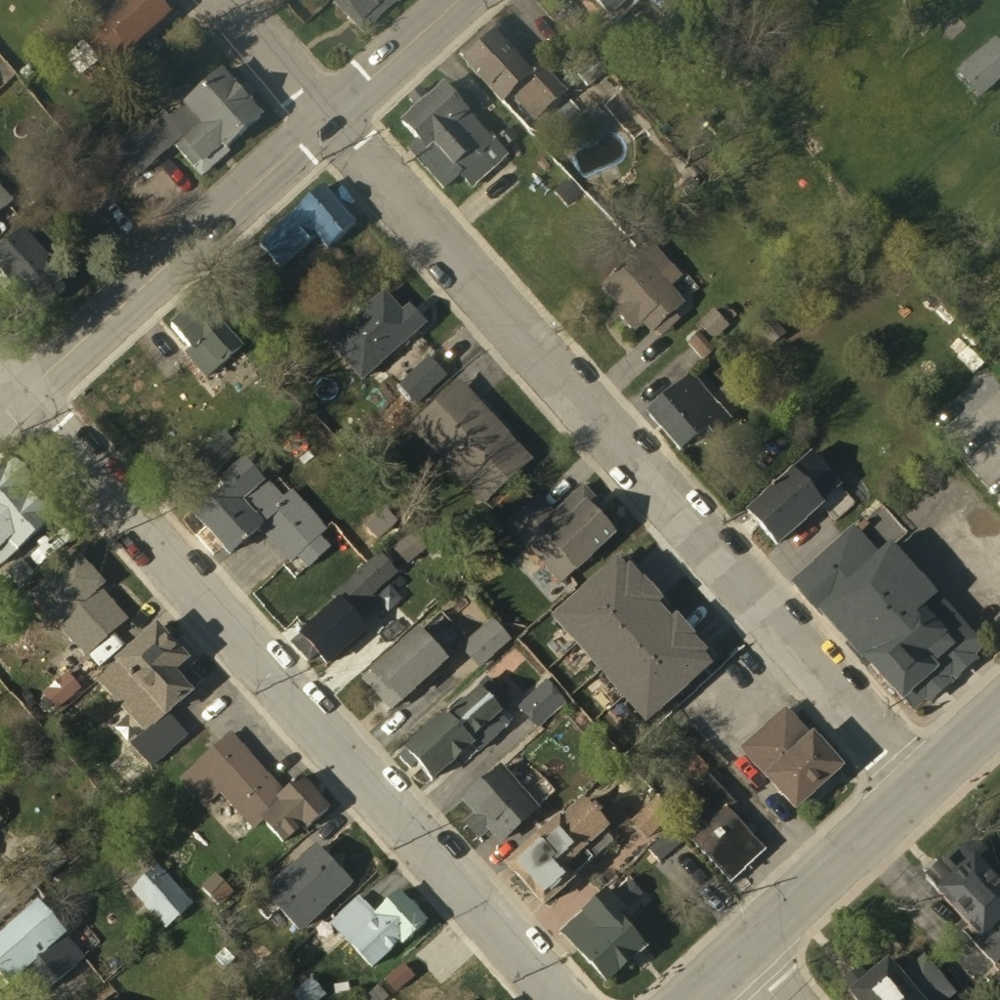
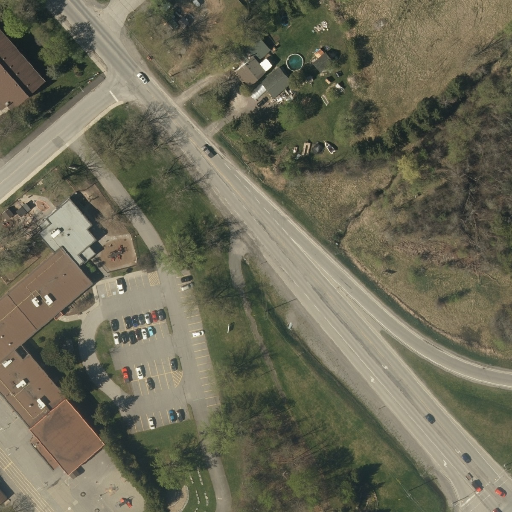

# AeriQuote — low-cost imagery feasibility, Phase2
October29,2026 (America/Edmonton). Research and isolated visual inspection only.

## Decision and checkpoint

Edmonton2025 and Eastern Ontario DRAPE2024 remain the strongest two legally promising regional options. This batch adds actual pixel inspection, not just metadata. Their suitability remains conditional on property visibility, source alignment and field verification. No measurement accuracy or commercial-launch approval is claimed.

Important new Saskatchewan finding: the sampled public SGIC imagery is2021/30cm, not uniformly60cm. Separately, official FlySask announcements describe2025 Saskatoon8cm Pictometry data. That member-data lead deserves a licensing inquiry; its pixels, vertical-versus-oblique suitability and downstream rights were NOT verified. Do not generalize the old ISC60cm product specification to every SGIC collection.

Starting recovery HEAD:a7f8591077b106af4529b514c3ef0a934045b53a, treea0abb6af3f61611651160cd4dc4a97d3227cd323. GitHub runs40946469548/40946469551 completed successfully. Render test dep-dbhqfri9lscs73a65dng LIVE for that exact commit. Read LOW_COST_IMAGERY_SUPPLY_2026_10_29.md, IMAGERY_LAUNCH_FEASIBILITY_2026_10_29.md and current general resume. Current research changes documentation/evidence only. Application code, imagery integrations, measurements, prices, PDFs, accounts and saved records untouched.

## 1. Actual source inspection — what was examined

No synthetic imagery or existing AeriQuote/customer account was used. Locations are identified by coordinates/tile IDs, not independently validated street addresses. These are public-source sample properties, not customer jobs.

### Edmonton — genuine original2025 GeoTIFF, visually inspected

- City of Edmonton official source dataset ibcg-evfy, file28683E593532N.tif,750m×750m,10,000×10,000 RGB pixels.
- GeoTIFF tags independently read:0.075m pixels,EPSG3776,NAD83/3TM114; top-left projected position(28683,5936079).
- Capture window:September–October2025 from City metadata. Exact flight day and survey-control accuracy report unavailable in this file/record.
- Tile footprint approximately53.5500–53.5568N,113.5672–113.5558W. Original target point53.555N,113.556W selected this actual tile.
- Downloaded300,080,484 bytes through the City's published public Drive file link. This is City imagery hosted on Drive, not Google Maps imagery.
- Examined full-tile overview plus native-pixel crops:residential roofs/detached rear garages, large building/parking/street, and school/service field. Image previews below are reduced display copies, not measurement rasters. Source hash/crop projected bounds are in evidence.json. [E1]

Observed:roof silhouettes and many roof transitions are distinctly visible; rear garages and paved alley access can be distinguished; large paved/grass extents and many sidewalk/curb edges are visually clear. Autumn trees remain leafy, with substantial shadows across roof edges, lawns and sidewalks. A construction site demonstrates why capture date matters. Cars block parts of parking boundaries. A roof edge is not automatically the ground-level wall/parcel boundary. No pitch, roof completeness or legal property boundary was inferred.

Assessment:strong visual candidate for manual Area/Linear and contractor-confirmed pitched Roofing where the entire relevant boundary is visible. Occluded sections require another verified source or field confirmation. Image clarity does not establish positional or quantity accuracy.

Contains information licensed under the Open Government Licence – City of Edmonton. Source:City of Edmonton,2025; display crops/recompression by AeriQuote research.

Access limitations:City ArcGIS folder returned403, Source Cooperative PMTiles endpoint403 and its published public S3 mirror503. No credentials or bypass attempted. The official GeoTIFF download succeeded through the normal large-file download confirmation. These access results are not an AeriQuote defect, nor proof that every prospective production endpoint will work.

### Eastern Ontario — actual DRAPE2024 pixels, visually inspected

Official Ontario GEO_Imagery_Data_Service_2023to2027/ImageServer was queried at:
- Residential:45.136N,76.145W, Carleton Place vicinity; primary raster102474,1km18409049980DRAPE2024.
- Commercial/rural-edge:45.129N,76.128W; primary raster102773,1km18411049970DRAPE2024.
Both catalog rows explicitly identify Project=DRAPE2024 and LowPS/HighPS=0.16m. Original ground sampling is16cm; service reprojection/export pixels are not an independent resolution improvement. Capture window March12–May31,2024; exact local flight day was not supplied by the catalog rows. Released project footprint35,993km²; stated45cm ground accuracy is provider specification, not independently verified here. [O1,O2]

Observed:houses, detached outbuildings/garages, driveways, street edges, commercial roof, parking bays, paved service areas and adjacent field are recognizable. Bare deciduous branches cast shadows; evergreen cover hides portions of boundaries. Parked vehicles obscure edges. Smaller roof corners and narrow paths have fewer source pixels than Edmonton and require more judgment. No invented roof details, pitch or hidden boundary was traced.

A single-raster-locked residential export initially showed a black edge where the requested view crossed that raster's footprint. Requesting the same AOI from the DRAPE2024-only mosaic supplied the adjacent imagery. This was expected single-tile extent behavior, not a confirmed application defect. A future adapter must verify coverage across the entire job, including garages, rather than treating a center-point hit as complete imagery.

Assessment:promising for larger service Areas/Linear routes and visible simple roof outlines; limited for small/occluded roof facets and thin curb work. Roofing remains conditional with explicit contractor pitches/section scope. No ground-truth comparison or measurement accuracy test performed.

Contains information licensed under the Open Government Licence – Ontario. Source:Geospatial Ontario,DRAPE2024; service export/display recompression by AeriQuote research.

### Saskatchewan — actual public2021 pixels, visually inspected

Used the public SGIC ImageServer, queried intersecting primary rasters, selected named2021 originals rather than older/overview rows, and exported locked raster IDs:
|Location/sample point|Actual catalog item|Source/year/native GSD|Observation|
|---|---|---|---|
|Saskatoon residential52.148N,106.670W|77683,37_05_3_RGBN_2021|SGIC-Geodesy,2021,0.300000012m|Roofs, small rear structures, driveways and main road visible; fine corners softened; tree branches/shadows obstruct some edges|
|Saskatoon industrial52.166N,106.670W|77683,same township original|Same|Large industrial roofs, storage areas and parked vehicles recognizable; narrow curb/edge location less distinct|
|Warman residential/park52.320N,106.570W|77706,39_04_3_RGBN_2021|SGIC-Geodesy,2021,0.300000012m|Roofs/rear structures, paved drives, paths and service park visible; tree shadows and softer edge detail|
|Warman expansion area52.310N,106.586W|77695,38_05_3_RGBN_2021|SGIC-Geodesy,2021,0.300000012m|Residential row and large vacant tract visible; not a parking-lot sample despite the initial research filename|

Catalog Date_of_Data and Accuracy fields were null. A secondary date-index point query returned no feature, so exact day/ground accuracy remains UNKNOWN.2021 is five years old; new construction/site changes must be verified. This is not the2025 high-resolution member product. [S1]

Assessment:potential for large, visible service extents after current-site confirmation; weak default for small roof facets/precise narrow Linear work. No approval to commercialize even if visibly adequate. Public service licenseInfo prohibits further commercial redistribution. Pixel copies were kept out of the GitHub/customer-facing evidence pack; committed evidence contains metadata, hashes and observations only. No commercial customer PDF made from SGIC imagery. [S2]

## 2. Exact licence position

|Source|Commercial tracing and derived geometry|Customer imagery PDFs/historical use|Remaining issue|
|---|---|---|---|
|Named City Edmonton open2025 orthophotos|Current OGL grants perpetual commercial copy/adapt/distribute rights; tracing/storage support is an interpretation of that broad grant|Supported by broad grant with attribution/compliance; source must be City's licensed information|API dataset licenseId is absent; preserve the City's current licence and confirm any tile-specific third-party exceptions; out-of-city Esri imagery is separate|
|Named DRAPE2024 open release|OGL–Ontario perpetual commercial adaptation/distribution supports retained contractor geometry|Supported with proper source/licence credit and compliance|Do not extend licence to unrelated mixed basemap layers; preserve collection/date|
|SGIC public2021 sample|No sufficient AeriQuote commercial grant verified|Public metadata explicitly bars further commercial redistribution|Written commercial authorization needed; source visibility is not permission|
|FlySask announced8cm member Pictometry|UNVERIFIED:member access does not itself grant OEM rights|UNVERIFIED, including after termination|Confirm imagery type, rightsholder chain and exact permission with SRC/SGIC/ISC|

Open licences do not authorize provider logos/endorsement or third-party rights the issuer cannot grant. Keep source/acquisition/licence attribution on imagery and PDFs. Exact City attribution:Contains information licensed under the Open Government Licence – City of Edmonton. Ontario:Contains information licensed under the Open Government Licence – Ontario. Tracing permission does not imply a cadastral/survey-accuracy warranty. [L1,L2]

The current Google workflow remains uncleared following Sean's MapsPeople correspondence. Neither an open-image pilot nor a new supplier retrospectively licenses earlier Google-derived material.

## 3. Saskatchewan commercial path — important new evidence

Official FlySask updates announce:
- Saskatoon2025 Pictometry RGB at0.08m, posted November6,2025.
-2024 Pictometry0.08m; the corrected community list is Estevan,Weyburn,Yorkton.
- Additional2024 ortho0.3m and2026 ortho0.25m, without a complete per-property coverage schedule in the announcement.
These are publisher announcements, not accessed pixels or verified province-wide coverage. “Pictometry RGB” does not prove nadir orthophoto/true-ortho geometry suitable for the existing top-down interface. [S3]

FlySask2's notice says replacement by FlySask3 on September30,2026. SRC's current page links FlySask3, distinguishes free basic viewing from high-resolution/member functions, and lists WMS/REST integration. The older FlySask2 terms prohibit monetary exploitation without prior SRC consent. A superseding commercial agreement is a possible negotiation route; willingness, authority, price and approved scope remain unknown. The new platform's complete applicable contract was not verified. [S4,S5]

Recommended sequence:
1. Ask SRC/SGIC to identify the licensing authority and exact vertical imagery available for Saskatoon/Warman, named smaller towns and rural areas. Ask whether upstream city/Pictometry rights permit commercial sublicensing.
2. Ask ISC as official distributor for the actual EULA/OEM alternatives, region/collection schedule and fixed/pooled licence quotation. Its low retail file prices do not establish SaaS rights.
3. If city-owned high-resolution captures are needed, obtain written City permission or rightsholder referral. Saskatoon's mapping disclaimer restricts storage/transfer/publication without express consent; its public viewer is not an open-data shortcut. [S6]
4. Require explicit multi-tenant users/employees, manual tracing, permanent editable polygons/numbers, hosted/cached imagery, branded PDF distribution/forwarding, historical survey access/reopening and post-termination rights. Resolve all upstream restrictions in writing.
5. Start with a bounded city+surrounding-community quote; only consider province-wide commitment after coverage/quality/cost validation.

Official channels:SGIC project manager Ian Radchenko,Ian.Radchenko@src.sk.ca,306-385-4232 on the still-published FlySask2 support page; confirm routing through SRC1-877-772-7227 because the platform transitioned. ISC1-866-275-4721. No outreach was made. [S7,S8]

### Prepared inquiry — UNSENT
Subject: Saskatchewan imagery licence for AeriQuote contractor SaaS

Hello SGIC licensing team,

I’m Sean Dusome, founder of AeriQuote, a contractor measurement and estimating SaaS for six industries.

We are seeking an imagery-only commercial agreement allowing independent businesses and their employees to trace property features, permanently retain contractor-created polygons and measurements, and distribute branded customer PDFs containing aerial photographs and overlays. We also need historical estimate reopening and clear retention rights after a subscription ends.

Your updates announce 2025 Saskatoon Pictometry imagery at8cm. Is suitable top-down orthophotography available, and which organization can authorize these uses, including any upstream rights? Please also identify current coverage, capture dates and native resolution for Warman, smaller communities and rural Saskatchewan.

Could you quote a pooled regional licence for Saskatoon and surrounding communities, plus a province-wide alternative, without requiring a separate imagery subscription for every contractor? Please include minimum commitments, APIs/bulk files, hosting/cache permissions, updates, attribution, PDF redistribution and reuse charges at1,000,10,000 and50,000 annual measurements.

We understand public viewing access does not authorize our commercial workflow. We will not integrate the imagery without the necessary written rights.

Thank you,
Sean Dusome
AeriQuote

## 4. Low-cost commercial suppliers

|Lead|Verified offering/limitations|Negotiation target|
|---|---|---|
|Tarin,orderdesk@tarin.ca,403-269-8228|Annual regional VIEWS WMS/orthophoto files. Published coverage map updated March2024, through2023 vintages; current local GSD/date not established. SPOT satellite layer is not assumed roof-grade|Saskatoon/AB pooled SaaS region, imagery-only files vs WMS; no per-employee seats; permanent geometry/PDF rights; min commitment/update/traffic caps|
|First Base Solutions,sales@firstbasesolutions.com,905-477-3600|Bulk MapWarehouse/MapCast bandwidth model. Dated2022 map shows5–15cm examples/Toronto8cm, not current universal imagery. MapCast help specifies2048px output/printing limits [F1]|Written OEM contract superseding internal-use/no-third-party/no-Internet EULA. Ensure PDF pixel sizes fit current designs; bulk files may be better than standard service|
|McElhanney,vancouver@mcelhanney.com,604-683-8521|Actual orthophoto catalogue/capture services; no blanket SK/US inventory, current GSD or SaaS tariff verified|Existing licensed regional stock before custom flights; confirm vendor owns sublicensing rights rather than merely holding a client's survey|
|Geodesy Group,Info@geodesygroup.com,403-938-6400 via official alliance listing|Public SGIC sample names this supplier; alliance lists its contact. This does not prove it can independently resell SGIC-owned imagery|Ask whether it has separately licensable stock and pooled OEM options, or must route to SGIC; do not treat it as a way around SRC terms|

Published FBS reference prices from official help:$70/500m tile,$150/1km tile; MapCast from$500/year/500MB monthly. These are dated retail references, currency/current applicability not confirmed; NOT an AeriQuote OEM quote. Pan/zoom/refresh consumes bandwidth. Standard FBS EULA is internal-business-only, bars third-party transfer and requires written Internet permission. [F1,F2] No supplier has offered a verified low-minimum nationwide Canada/U.S. agreement.

## 5. Financial feasibility — full allowance stress test

Assume USD plan prices; confirm vendor/invoice FX. All licensing fees/unit rates below are hypothetical, not quotations. Use prior documented bounded500GB regional corpus and reserves:
- Open recurring fixed:$910/year =storage90+delivery service60+monitor/backup operations60+update labour600+processing compute100.
- Initial ingestion/QA$1,200 plus common approved-future adapter/acceptance reserve$6,000, not spent.
- Open variable$0.01/completed job:assumed0.004 tile/proxy CPU+0.003 customer-PDF aerial rendering+0.003 reopen/retry operations. No benchmark claimed.
-50MB imagery traffic and120 requests per job assumed;50k jobs≈2.5TB/year. Current R2 Standard has$0.015/GB-month,read/write charges and free direct egress; other services/CPU can charge. Free tiers ignored. [C1]
- Fixed commercial example adds$3,000/year to same self-hosting budget.
- Metered example$0.10/vendor transaction×1.5 charged transactions/job plus$360/year API operations; provider hosting/PDF extraction included by assumption. A different quote may bill tiles/bytes or charge exports separately.

|Annual jobs in usable region|Open first year|Open ongoing/year|$3k licence ongoing/year|$0.10 transaction ongoing/year|
|---:|---:|---:|---:|---:|
|1,000|$8,120|$920|$3,920|$510|
|10,000|$8,210|$1,010|$4,010|$1,860|
|50,000|$8,610|$1,410|$4,410|$7,860|

Do not allocate a regional licence against jobs outside its footprint. More regions/vintages can increase storage, licence and update work. This does not cover national rollout, total SaaS operating costs or separate address/Street View licensing/bills.

At FULL monthly allowances, annual measurement capacities are300/900/2400 and subscription revenues348/708/1188. Revenue per allowed job is1.16/0.7867/0.495. A hypothetical20% imagery budget implies0.232/0.1573/0.099 per job; this is a modelling choice, not a guaranteed margin.

|Scenario|Cost/job|Basic25/month|Pro75/month|Business200/month|
|---|---:|---:|---:|---:|
|Open,10k regional jobs/year,ongoing|$0.1010|$2.53|$7.58|$20.20|
|Open,50k,ongoing|$0.0282|$0.71|$2.12|$5.64|
|$3k licence,50k,ongoing|$0.0882|$2.21|$6.62|$17.64|
|20% paid quality/coverage fallback,50k|$0.1012|$2.53|$7.59|$20.24|
|$0.10×1.5 transactions,50k|$0.1572|$3.93|$11.79|$31.44|
|Open,50k,FIRST YEAR including startup reserve|$0.1722|$4.31|$12.92|$34.44|
|Open,50k,startup spread over3years|$0.0762|$1.91|$5.72|$15.24|

Monthly costs include an allocated share of fixed regional spend, not just variable requests. Decimal ROUND_HALF_UP checked independently; financial JSON stores assumptions/results. All modelled customers use their complete allowance; there is no dependence on low average use or changing customer allowances.

The20% fallback case uses20%×1.5×$0.25 plus80%×$0.01, giving$0.083 variable/job; with910/50k overhead total is0.1012. Reopen charges after a vendor's reuse window and imagery too coarse/old/occluded all count as potential gaps.

At50k, the maximum recurring fixed imagery licence fitting the Business20% budget under these assumptions is$3,540/year. At10k, even open operations slightly exceed that budget, leaving no positive licence room. Including startup costs reduces the room further. An affordable regional contract must be evaluated against subscriber ramp and real usage density, not only a long-run cent figure. No change to plan pricing/allowances proposed.

## 6. Implementation complexity — preserve the engine

Planning estimate:roughly2–4 engineering weeks after usable data/access/rights are established;120h in the model is a reserve, not a commitment or completed work. Isolated source-alignment/quality proof comes first. Retain Leaflet, area/length mathematics, pitch adjustment, multi-area/garage handling, server quote validation, pricing/tax/account controls and approved PDF layouts.

Future work would be an imagery adapter/data-preparation boundary:reproject native EPSG3776/other source rasters correctly to Leaflet's map CRS; verify world-pixel bounds/datum alignment; provide permitted detailed imagery and report crops; handle multi-tile coverage/retries/reopening; include attribution and authorized retention. Do not simply stretch a transverse-Mercator source over guessed bounds, shift saved vertices, or upscale imagery and call it more accurate.

PDF design can stay, but image acquisition/compositing needs licensed source pixels, accurate overlays and CORS-safe capture. Inspect actual Single/Expanded outputs at phone/tablet/desktop sizes after a later approved pilot. This batch did not generate AeriQuote PDFs or run application workflows. No separate roof engine or new drawing tools are justified.

Manual roof pitches/section completeness remain contractor-confirmed. Nearmap/open aerial pixels do not supply Solar geometry. Preserve AutoMeasure code and QA gates. Historical Google records need their own approved licensing/retention decision, not silent migration or repricing.

## 7. Recommended next sequence and stop point

1. Review this report. Prioritize SRC/SGIC licensing clarification because announced2025/8cm Saskatoon data may be locally valuable; no permission/quote assumed.
2. Confirm Edmonton collection-specific exceptions/accuracy metadata and Ontario DRAPE tile dates/service limits. Their broad open grants are materially more promising than standard restricted commercial subscriptions.
3. After outreach approval, obtain Tarin pooled-region and FBS OEM quotes; pursue separately licensable survey stock if necessary.
4. After technical-pilot approval, independently check sample field lengths/areas and source alignment, then exercise all six industries, pitch/scope, save/reopen and actual PDFs in isolation. Sample field controls require independent verified information; visual clarity alone cannot pass measurement accuracy.
5. Approve any integration only after rights, per-region quality and full-use economics pass. No implementation began here.

Remaining unverified:ground-truth measurement/roof accuracy, per-property flight days,2025 Saskatchewan member pixels/type, binding Saskatchewan/OEM grants, actual commercial quotations, production delivery performance and real PDF integration. No physical-device or authenticated application tests claimed. Prior app CI/Render status was verified; application regressions were not repeated merely for research documentation. No real customer records, vendor messages, purchases, new services or production changes. STOP for review.

## Sources and evidence

E1 City Edmonton2025 catalogue/map:https://data.edmonton.ca/dataset/Orthophoto-Repository-2025/ibcg-evfy ; https://data.edmonton.ca/dataset/Orthophoto-Repository-2025-Map/3r8m-cnxp
Exact tile index query:resource/ibcg-evfy.json with intersects(geometry_multipolygon,'POINT (-113.556 53.555)'); original public file:https://drive.google.com/file/d/1urMnlCQWnYJqEbc1bbszCFuAvn9lA-6H/view
O1 Official DRAPE catalogue/licence:https://data.ontario.ca/dataset/open-ontario-imagery/resource/84111458-d36a-4e0a-b10e-cb9bf18880c8
O2 Actual Ontario export/query service:https://ws.geoservices.lrc.gov.on.ca/arcgis5/rest/services/AerialImagery/GEO_Imagery_Data_Service_2023to2027/ImageServer
S1 Actual SGIC catalog/export service:https://gis.saskatchewan.ca/imagery/rest/services/SGIC_Public_Orthophotos/ImageServer
S2 Public service restriction:https://gis.saskatchewan.ca/imagery/rest/services/SGIC_Public_Orthophotos/ImageServer/info/iteminfo?f=pjson
L1 Current City OGL portal:https://data.edmonton.ca/stories/s/Open-Government-Licence-Edmonton/msh8-if28/
L2 OGL–Ontario:https://www.ontario.ca/page/open-government-licence-ontario
S3 Official member-data announcements,including correction:https://www.flysask2.ca/category/imagery-update/
S4 SRC current programme:https://www.src.sk.ca/services/flysask-ortho-photography ; transition:https://www.flysask2.ca/
S5 Earlier portal terms:https://www.flysask2.ca/terms/ (do not assume these are the complete FlySask3 signed terms)
S6 City Saskatoon mapping restrictions:https://www.saskatoon.ca/disclaimers
S7 Published SGIC project contact:https://www.flysask2.ca/technical-support/
S8 ISC distribution/EULA/retail refs:https://www.saskregistries.ca/MapsandPhotos/Imagery/SGICOrthoImagery
Tarin:https://www.tarin.ca/ ; dated coverage:https://www.tarin.ca/s/OrthoCoverage_ByYear.pdf
F1 Product output/price references:https://www.firstbasesolutions.com/faqs ; dated coverage PDF and contact in prior supply report
F2 Standard FBS EULA:https://maps.firstbasesolutions.com/legal.php ; contact:https://www.firstbasesolutions.com/contact/
McElhanney catalogue:https://www.mcelhanney.com/vertisee/ ; regional contact:https://www.mcelhanney.com/locations/vancouver-british-columbia/
Geodesy official alliance contact:https://www.geosysalliance.com/location
C1 Hosting tariff:https://developers.cloudflare.com/r2/pricing/

Machine evidence:qa/imagery-phase2-2026-10-29/evidence.json. Financial assumptions/results:qa/imagery-phase2-2026-10-29/financial.json. Public-source preview images are research documentation, not customer estimates or a proposed PDF redesign. No SGIC pixels are committed. Original300MB GeoTIFF is reproducible from City's source and not duplicated into Git.
